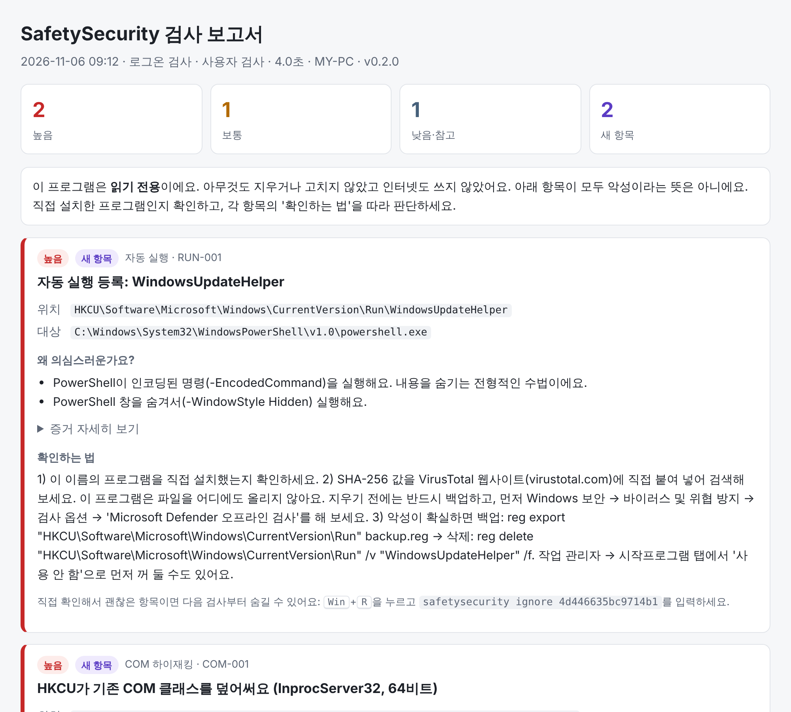

<p align="center">
  <picture>
    <source media="(prefers-color-scheme: dark)" srcset="docs/assets/banner-dark.svg">
    
  </picture>
</p>

<p align="center">
  <a href="https://github.com/jiyul-me/safety-security/actions/workflows/ci.yml"></a>
  <a href="LICENSE"></a>
  
  
  
  
</p>

<p align="center">
  <b>A read-only scanner that finds the "autostart traces" malware quietly leaves on your PC</b><br>
  It never deletes or changes anything and never goes online. While you play a game, it waits quietly.
</p>

<p align="center">
  <a href="#quick-start">Quick start</a> ·
  <a href="#what-it-checks">What it checks</a> ·
  <a href="docs/DETECTIONS.en.md">Detection rules</a> ·
  <a href="docs/TESTING-ON-YOUR-PC.en.md">Testing on your PC</a> ·
  <a href="docs/ARCHITECTURE.en.md">Architecture</a> ·
  <a href="CONTRIBUTING.en.md">Contributing</a> ·
  <a href="README.md">한국어</a>
</p>

---

> **Note:** the app's interface, notifications and reports are in Korean only. The installer is available in English and Korean.

> **Why this exists**: when the launcher on a gaming PC was hacked, the malware quietly registered itself under `HKCU\Software\Classes\CLSID\{…}\InprocServer32`
> so that Chrome loaded a malicious DLL (COM hijacking, MITRE ATT&CK [T1546.015](https://attack.mitre.org/techniques/T1546/015/)).
> Entries like this can be created without administrator rights and are easy to miss. SafetySecurity checks for these traces regularly.

## Quick start

No PowerShell needed.

1. Download **`SafetySecurity-Setup-x.y.z.exe`** from [Releases](https://github.com/jiyul-me/safety-security/releases/latest).
2. Double-click the downloaded file. If a "Windows protected your PC" window appears, click **More info → Run anyway** ([why this appears](#install)).
3. Choose an install mode.
   - **Install for my account only** (recommended): installs right away, with no permission prompt.
   - **Install with administrator rights**: also checks the Defender exclusion list, hidden scheduled tasks and WMI subscriptions. A permission prompt appears. Choose this only when you are signed in with an administrator account ([why](#limitations-please-read)).
4. On the additional tasks screen, **Create a desktop shortcut** is on by default. Untick it if you don't want one.
5. On the last screen, leave **Scan now** ticked and click Finish. The report opens when the scan is done.

> The installer is available from v0.2.0. For earlier versions, see [Command-line install](#install) below.
>
> If you were using v0.1.0 from the zip with `install --admin`, choose **administrator rights** as the install mode. If you choose "my account only", the old administrator scan task stays behind and keeps running the old exe.

> [!WARNING]
> SafetySecurity **cannot be installed yet on PCs with Smart App Control turned on.** The installer and the exe are not code-signed, so Windows blocks them (unlike the SmartScreen window, there is no "Run anyway" button).
> You can check whether it is on under Windows Security → App & browser control → Smart App Control settings.
> **We do not recommend turning Smart App Control off** to use this program. Depending on your Windows version, once it is off it cannot be turned back on without reinstalling (resetting) Windows.

After that, there is nothing to look after. It runs a short scan at logon, once a day and whenever a new service is installed, and shows a notification only when there is a new suspicious item.

| What you want | How |
|---|---|
| Scan now | **SafetySecurity** on the desktop or in the Start menu (a notification shows while it scans; the report opens when it finishes) |
| Hide an item you've checked | As the report says, <kbd>Win</kbd>+<kbd>R</kbd> → `safetysecurity ignore <ID>` (it shows the item's severity and title and asks once more) |
| See or restore hidden items | <kbd>Win</kbd>+<kbd>R</kbd> → `safetysecurity ignored`; to restore one, `safetysecurity unignore <ID>` |
| Check status | <kbd>Win</kbd>+<kbd>R</kbd> → `safetysecurity status` (last scan, deferred scans, registered tasks, whether notifications are on) |
| Uninstall | Settings → Apps → Installed apps → **SafetySecurity** → Uninstall (removes the scheduled tasks too) |

<p align="center">
  <picture>
    <source media="(prefers-color-scheme: dark)" srcset="docs/assets/report-dark.png">
    
  </picture>
  <br><sub>Example report (<a href="docs/sample-report.html">sample-report.html</a>). Each finding comes with the reason, the evidence and how to check it yourself.</sub>
</p>

## Features

| | |
|---|---|
| **Off most of the time** | No resident process. Windows Task Scheduler wakes it at logon, once a day and when a new service is installed; it scans and exits right away. |
| **Stays out of your games** | If it sees a fullscreen game, a game process or high CPU usage, it defers the scan and checks again 30 minutes later. It also stops if a game starts mid-scan. Even a scan overdue by more than a day is not run while a listed game is open; it just tells you once that the scan is overdue. |
| **Lightweight** | It puts only its own process into background mode (low CPU and disk priority) and efficiency mode, and scans slowly on a single thread. Signature results are cached, so scans after the first are much faster. |
| **No conflicts with anti-cheat (Vanguard and others)** | It uses **no** kernel driver, no opening other processes (`OpenProcess`), no memory access, no code injection and no hooks. Running programs are seen by name only, from a snapshot that opens no handles. When a `schtasks` or `powershell` run times out, it ends only that one process it started itself. |
| **Read-only** | Registry keys are opened with read access only, files in read mode only. The report tells you how to fix things; you make any actual changes yourself. |
| **Offline** | No network code. Certificate revocation checks (CRL/OCSP) are turned off for signature checks. If an autostart entry points to a file on a network share, WebDAV or a mapped network drive, it judges from the path alone and never opens the file. |
| **Protects itself** | It reports scheduled tasks that imitate the SafetySecurity name and SafetySecurity tasks that have been disabled. Administrator scans keep their settings and records in a folder only administrators can change, and do not pass the user's environment variables to the Windows tools they start. |

These promises are not just words; the code enforces them.

- [`BannedSymbols.txt`](BannedSymbols.txt): using network, registry-write, file-delete or other-process APIs **fails the build**.
- [`ForbiddenApiTests.cs`](tests/SafetySecurity.Core.Tests/ForbiddenApiTests.cs): declaring Win32 functions such as `OpenProcess`, `WriteProcessMemory` or `SetWindowsHookEx` **fails the tests**.

## What it checks

Each rule ID is described in detail in [docs/DETECTIONS.en.md](docs/DETECTIONS.en.md).

| Category | Where it looks | Treated as especially risky |
|---|---|---|
| **COM hijacking** | `InprocServer32`, `LocalServer32`, `TreatAs`, `ScriptletURL` under `HKCU\Software\Classes\CLSID` (64- and 32-bit) | An HKCU entry that **overrides** the HKLM entry for the same CLSID and points to an unsigned DLL or a DLL in a user folder; keys created in the last 7 days |
| Autostart | Run/RunOnce keys, Startup folders (.lnk targets analyzed), Winlogon `Shell`/`Userinit`, `AppInit_DLLs`, `AppCertDlls`, IFEO debuggers, SilentProcessExit, logon scripts, cmd AutoRun | Abuse patterns such as `powershell -enc`, `mshta`, `rundll32 javascript:`; unsigned executables in temp folders. Commands wrapped in `cmd /c`, `start`, PowerShell `Start-Process` and the like are judged by **the file that actually runs**, and shortcuts whose visible target differs from the real one are reported |
| Services and drivers | `ImagePath`, `ServiceDll` under `HKLM\SYSTEM\CurrentControlSet\Services` | Drivers or service DLLs in user folders, unquoted paths |
| Scheduled tasks | Queried with `schtasks /query /xml` | Hidden task + executable in a user folder, LOLBin abuse, tasks imitating the SafetySecurity name |
| Hidden tasks (admin) | `TaskCache\Tree` | Tasks whose security descriptor (SD) was removed (the Tarrask technique) |
| Browsers | Chrome, Edge, Brave and Whale policies, system proxy, browser shortcuts | Force-installed extensions, `--load-extension` or remote debugging arguments |
| Defender | Disable policies, exclusion list (local exclusions need admin) | Excluding whole user folders or executable file extensions |
| hosts file | `drivers\etc\hosts` | Blocking or redirecting security, update or game sites (lines that only block telemetry or ad addresses are informational) |
| **Discord** | `discord_desktop_core\index.js` of the Discord, PTB, Canary and Development apps in `%LOCALAPPDATA%` | Startup files modified by token-stealing malware (often spread through game cheats and cracks). BetterDiscord is "Low" |
| WMI subscriptions (admin) | `root\subscription` | CommandLine/ActiveScript consumers |
| New executables | AppData, LocalAppData, Temp, ProgramData, Public (top level + one level down) | Unsigned executables created in the last 14 days, double extensions such as `invoice.pdf.exe`, executables with a disguised extension |

**How false positives are kept down**
- A valid digital signature lowers the severity (Windows catalog signatures are checked too).
- The first scan's results are saved as a **baseline**. After that, only *new* items trigger a notification. In case the PC is already infected, the first scan notifies only "High" items (the same applies the first time a category added in a new version is scanned).
- An item in the same place is reported again as "changed" if it becomes riskier or the file behind it changes (signature, signer, SHA-256).
- You can hide items you've checked and found to be fine. Each item in the report says how (if you installed with the installer, <kbd>Win</kbd>+<kbd>R</kbd> → `safetysecurity ignore <ID>`). A hidden item is tied to its state when you hid it, so it shows up again if it becomes riskier or its file changes.

## Install

**Installer (recommended)**: run `SafetySecurity-Setup-x.y.z.exe` as described in [Quick start](#quick-start).
The installer puts the executable in the location below and registers it in the Start menu, on the desktop (optional, on by default) and in the app list. Task Scheduler registration is handled by `SafetySecurity.exe install`.

| Install mode | Executable location | Permission prompt |
|---|---|---|
| My account only | `%LOCALAPPDATA%\Programs\SafetySecurity` | None |
| Administrator rights | `C:\Program Files\SafetySecurity` | UAC prompt |

Running the installer again **updates in the same mode** without asking. To switch modes ("my account only" ↔ "administrator rights"), first uninstall from Settings → Apps, then install again and choose the mode.
The `/ALLUSERS` and `/CURRENTUSER` command-line switches cannot change the mode either. If a copy installed in the other mode exists, the installer stops without changing anything (with both installed, uninstalling one would also remove the other's automatic scans).
When uninstalling a "my account only" install, answer **No** to "Also delete scan history and reports?" to keep your scan history and pick up where you left off.

**Check that the downloaded file is genuine (recommended)**
```powershell
Get-FileHash .\SafetySecurity-Setup-x.y.z.exe -Algorithm SHA256   # compare with SHA256SUMS.txt
gh attestation verify .\SafetySecurity-Setup-x.y.z.exe --repo jiyul-me/safety-security
# You can check the installed executable too (for an admin install: C:\Program Files\SafetySecurity\SafetySecurity.exe)
gh attestation verify "$env:LOCALAPPDATA\Programs\SafetySecurity\SafetySecurity.exe" --repo jiyul-me/safety-security
```

> There is no code-signing certificate yet, so the first run shows a SmartScreen warning ("Windows protected your PC").
> Click "More info" → "Run anyway". Verify the file first with the hash and provenance attestation above.
> For the same reason, it **cannot be installed yet on PCs with Smart App Control turned on** (see the warning in [Quick start](#quick-start)). Free open-source code signing is being looked into separately.

<details>
<summary><b>Command-line install (zip)</b></summary>

1. Download `SafetySecurity-x.y.z-win-x64.zip` from Releases, extract it, and go to that folder in PowerShell (you can type `cd ` and drag the folder in).
2. Install. This copies the executable to the location in the table above and registers the tasks.
   ```powershell
   .\SafetySecurity.exe install           # my account only
   .\SafetySecurity.exe install --admin   # also add the administrator scan (shows a UAC prompt)
   ```
3. To uninstall, run `.\SafetySecurity.exe uninstall` (from an administrator PowerShell if it was an admin install), then delete the folder from the table above. `uninstall --purge` run from an administrator PowerShell deletes only the administrator scan records (`C:\Program Files\SafetySecurity\data`) and leaves your account's `%LOCALAPPDATA%\SafetySecurity` in place.

</details>

**Why install as administrator**
- The executable goes into `Program Files`, which makes it harder for malware running with normal rights to swap out the scanner itself.
- The administrator scan's settings, records and reports are kept in `C:\Program Files\SafetySecurity\data`, which only administrators can change.
- It also checks items only administrators can read, such as the Defender local exclusion list, hidden scheduled tasks and WMI subscriptions.

Installing creates the tasks below in the `\SafetySecurity\` folder of Task Scheduler.

| Task | When | What it does |
|---|---|---|
| `Logon` | 3 minutes after logon | Full scan (skipped if a full scan finished within the last 2 hours and no scan is deferred) |
| `Daily` | Once a day (after the PC is turned on, if it was off) | Full scan (skipped within 2 hours, like `Logon`) |
| `ServiceInstalled` | New service installed (System log event 7045) | Quick scan of services and scheduled tasks only |
| `Retry` | Every 30 minutes | Scans only if a scan was deferred (because of a game or an overlapping scan); otherwise exits within 0.1 seconds |
| `Admin` (admin install only) | Logon + check every 30 minutes, once a day | Scans administrator-only items |
| `ServiceInstalledAdmin` (admin install, fallback) | New service installed (event 7045) | Created only on PCs where `ServiceInstalled` could not be registered. Quick scan of services and hidden scheduled tasks with administrator rights |

All tasks run at priority 7 (low), with a 15-minute limit and no parallel instances. If an automatic scan overlaps another scan, it is not dropped but kept as a deferred scan for `Retry` to handle.
If a scan deferred because of a game, fullscreen or CPU load has waited more than a day (24 hours), it is no longer deferred for CPU or fullscreen and runs at low priority (at most once every 6 hours). If a listed game is running, it still does not scan and shows a "검사가 밀렸어요" ("Scan overdue") notification once.

## Usage

```
SafetySecurity.exe                    Scan now and open the report (same as double-click, desktop, Start menu)
SafetySecurity.exe scan --force       Scan now, even during a game
SafetySecurity.exe status             Last scan, deferred scans, registered tasks, notification settings
SafetySecurity.exe report             Open the last report
SafetySecurity.exe ignore <ID>        Hide an item (the ID is in the report; the first 8+ characters are enough)
SafetySecurity.exe ignored            List hidden items (both user and administrator scans)
SafetySecurity.exe unignore <ID>      Show a hidden item again
SafetySecurity.exe verify <file>      Check one file's digital signature (network paths are refused)
SafetySecurity.exe test-notify        Test whether notifications appear
SafetySecurity.exe help               Help (--help, -h and /? work too)
SafetySecurity.exe uninstall [--purge]
```

The first argument is always a command. An unknown option (e.g. `--foo`) shows the help instead of starting a scan. It scans right away only when run with no arguments.
`ignore` accepts only IDs from the recent scan history or a report. A typo or unknown ID is refused without saving anything, and it finds administrator scan items on its own even without `--scope` (those items ask for administrator rights).

If you installed with the installer, you can run commands like `safetysecurity status` from <kbd>Win</kbd>+<kbd>R</kbd> without PowerShell. Results are shown in a message box. A `scan` run from Win+R (e.g. `safetysecurity scan --force`) also shows the "검사하고 있어요" ("Scanning…") notification like the desktop icon does, and opens the report when it finishes.
A scan you start yourself (running with no arguments, desktop or Start menu, `scan --force`) runs for up to 30 minutes (automatic scans: 12 minutes). If it takes too long and stops, it tells you so, and the `Retry` task finishes the rest in the background.

When there are suspicious items, a Windows notification appears; clicking it opens the HTML report. Each item in the report includes:
- **Why it is suspicious**
- **Evidence**: signature status, signer, SHA-256, when the file or registry key was created or changed
- **How to check it yourself**: searching the hash on VirusTotal (you do the search yourself; the program uploads nothing), a backup command (`reg export`), and commands to disable or remove it

If Windows notifications are turned off (for this app only, for all apps, or by a work or school policy), the report's "확인하지 못한 것" ("What couldn't be checked") section and `status` tell you so and explain how to turn them on (Settings → System → Notifications). Focus assist (Do Not Disturb) cannot be detected.

Reports and records are in the data folder (`reports\`, `logs\scan.log`, `config.json`, `state*.json`).

| Who ran it | Data folder |
|---|---|
| Normal rights (automatic scan tasks, desktop, Start menu, Win+R) | `%LOCALAPPDATA%\SafetySecurity\` |
| Administrator rights (`Admin` task, admin install/uninstall, administrator PowerShell, PCs with UAC turned off) | `C:\Program Files\SafetySecurity\data\` (only administrators can change it) |

The administrator scan uses its own `config.json` and hidden-items list. Normal users can read its reports, but only administrators can change the administrator scan's game list, notification threshold and hidden-items list. `status` shows both. The `state.admin.json` and `sigcache.admin.json` files that older versions left in `%LOCALAPPDATA%\SafetySecurity` are no longer used and can be deleted.

### Configuration (`config.json`)

```json
{
  "gameProcesses": ["VALORANT-Win64-Shipping.exe", "League of Legends.exe", "..."],
  "notifyMinSeverity": "Medium",
  "cpuBusyPercent": 60,
  "deferOnFullscreen": true
}
```

## Limitations (please read)

- **It is not an antivirus.** It does not compare file contents against malware signatures. It is a tool to use *alongside* an antivirus such as Windows Defender.
- Results mean "suspicious", not "confirmed". Legitimate programs can be flagged, and very sophisticated malware may be missed.
- With a normal-user install, malware running with the same rights can change the scanner's files or records (`%LOCALAPPDATA%\SafetySecurity`). That is why an administrator install is recommended: it keeps the executable and the administrator scan's records in `C:\Program Files\SafetySecurity`, which only administrators can change.
- If you choose administrator rights on a **standard (non-admin) account** and enter another administrator account's password, the automatic scan tasks are registered under that administrator account and do not run in your current account. On a standard account, choose "my account only".
- Malware that deceives Windows itself, such as kernel rootkits, is hard to find with a user-mode tool. If you suspect one, run a Microsoft Defender Offline scan.
- The full list of known limitations is in [SECURITY.en.md](SECURITY.en.md#known-limitations).

## Build from source

Requirements: [.NET 10 SDK](https://dotnet.microsoft.com/download)

```bash
dotnet build SafetySecurity.slnx           # works on macOS and Linux too
dotnet test tests/SafetySecurity.Core.Tests # rule tests (work on macOS and Linux too)
```

To build the NativeAOT single exe on Windows (requires the Visual Studio "Desktop development with C++" workload):

```powershell
dotnet publish src/SafetySecurity -c Release -r win-x64 -o out
pwsh tests/integration/Run-Integration.ps1 -Exe out/SafetySecurity.exe   # integration tests (create fake entries in HKCU, then remove them)
```

To build a Windows exe on macOS, skip NativeAOT and use this instead (the file is a bit larger but works the same):

```bash
dotnet publish src/SafetySecurity -c Release -r win-x64 -p:PublishAot=false --self-contained -p:PublishSingleFile=true -o out
```

### Project structure

```
src/SafetySecurity.Core/   Rules, scanners, reports (no Windows APIs, testable anywhere)
src/SafetySecurity/        Windows glue: registry, signature checks (WinVerifyTrust), game detection, Task Scheduler, notifications
tests/                     Unit tests (fake registry and file system), Windows integration tests
installer/                 Installer (Inno Setup script)
tools/Test-OnMyPC.ps1      Guided script for safely testing on your own PC
docs/                      Detection rules, architecture, testing guide, repository maintenance
```

See [docs/ARCHITECTURE.en.md](docs/ARCHITECTURE.en.md) for the architecture in detail, and [CONTRIBUTING.en.md](CONTRIBUTING.en.md) for how to contribute and the branching strategy.

### Testing on your PC

The guided script `tools/Test-OnMyPC.ps1` creates fake entries, checks that they are detected, and always removes them. The steps are in [docs/TESTING-ON-YOUR-PC.en.md](docs/TESTING-ON-YOUR-PC.en.md).

## License

[MIT](LICENSE) · Report security issues via [SECURITY.en.md](SECURITY.en.md) · [Code of Conduct](CODE_OF_CONDUCT.en.md) · [Changelog](CHANGELOG.md) (Korean)
