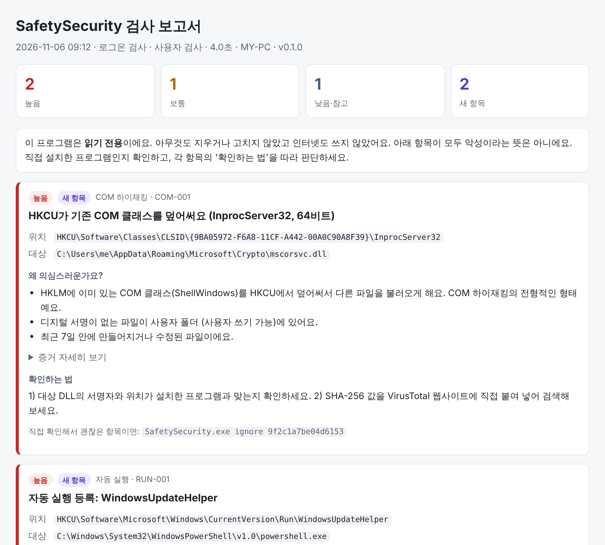

<p align="center">
  <picture>
    <source media="(prefers-color-scheme: dark)" srcset="docs/assets/banner-dark.svg">
    
  </picture>
</p>

<p align="center">
  <a href="https://github.com/jiyul-me/safety-security/actions/workflows/ci.yml"></a>
  <a href="LICENSE"></a>
  
  
  
  
</p>

<p align="center">
  <b>악성코드가 PC에 몰래 남겨 두는 "자동 실행 흔적"을 찾아서 알려주는 읽기 전용 검사기</b><br>
  아무것도 지우거나 고치지 않고, 인터넷도 쓰지 않아요. 게임 중에는 조용히 기다려요.
</p>

<p align="center">
  <a href="#빠른-시작">빠른 시작</a> ·
  <a href="#무엇을-검사하나요">검사 항목</a> ·
  <a href="docs/DETECTIONS.md">탐지 규칙</a> ·
  <a href="docs/TESTING-ON-YOUR-PC.md">PC에서 시험하기</a> ·
  <a href="docs/ARCHITECTURE.md">구조</a> ·
  <a href="CONTRIBUTING.md">기여하기</a> ·
  <a href="#english">English</a>
</p>

---

> **만든 계기**: 한 게임 PC 런처가 해킹됐을 때 악성코드가 `HKCU\Software\Classes\CLSID\{…}\InprocServer32`에 몰래 등록돼서
> Chrome이 악성 DLL을 불러오게 만든 일이 있었어요 (COM 하이재킹, MITRE ATT&CK [T1546.015](https://attack.mitre.org/techniques/T1546/015/)).
> 이런 등록은 관리자 권한 없이도 만들 수 있고 눈에 잘 안 띄어요. SafetySecurity는 이런 흔적을 주기적으로 확인해요.

## 빠른 시작

```powershell
# 1. Releases에서 zip을 받아 압축을 풀고, 관리자 PowerShell에서
.\SafetySecurity.exe install --admin

# 2. 지금 한 번 검사해 보기 (보고서가 열려요)
.\SafetySecurity.exe

# 3. 상태 확인
.\SafetySecurity.exe status
```

그다음부터는 신경 쓸 필요가 없어요. 로그온할 때, 하루 한 번, 새 서비스가 설치될 때 알아서 잠깐 검사하고, 새로운 의심 항목이 있을 때만 알림을 띄워요.

<p align="center">
  <picture>
    <source media="(prefers-color-scheme: dark)" srcset="docs/assets/report-dark.png">
    
  </picture>
  <br><sub>보고서 예시 (<a href="docs/sample-report.html">sample-report.html</a>). 항목마다 이유, 증거, 직접 확인하는 법이 있어요.</sub>
</p>

## 특징

| | |
|---|---|
| **평소엔 꺼져 있어요** | 상주 프로세스가 없어요. Windows 작업 스케줄러가 로그온, 하루 한 번, 새 서비스 설치 때 깨우면 검사하고 바로 끝나요. |
| **게임을 방해하지 않아요** | 전체 화면 게임, 게임 프로세스, 높은 CPU 사용률이 보이면 검사를 미루고 30분 뒤에 다시 확인해요. 검사 중에 게임이 시작돼도 멈춰요. |
| **가벼워요** | 자기 프로세스만 백그라운드 모드(낮은 CPU·디스크 우선순위)와 효율 모드로 돌리고, 한 줄로(단일 스레드) 천천히 검사해요. 서명 확인 결과를 캐시해서 두 번째 검사부터는 훨씬 빨라요. |
| **안티치트(뱅가드 등)와 충돌하지 않아요** | 커널 드라이버, 다른 프로세스 열기(`OpenProcess`), 메모리 접근, 코드 주입, 후킹을 **전혀** 쓰지 않아요. 실행 중인 프로그램은 핸들을 열지 않는 스냅샷으로 이름만 봐요. |
| **읽기 전용** | 레지스트리는 읽기 권한으로만, 파일은 읽기 모드로만 열어요. 고치는 방법은 보고서에 적어 줄 뿐, 실제 수정은 사용자가 직접 해요. |
| **오프라인** | 네트워크 코드가 없어요. 서명 확인 때 인증서 폐기 확인(CRL/OCSP)도 꺼 뒀어요. |

이 약속들은 말로만 하는 게 아니라 코드로 강제돼요.

- [`BannedSymbols.txt`](BannedSymbols.txt): 네트워크, 레지스트리 쓰기, 파일 삭제, 다른 프로세스 접근 API를 쓰면 **빌드가 실패**해요.
- [`ForbiddenApiTests.cs`](tests/SafetySecurity.Core.Tests/ForbiddenApiTests.cs): `OpenProcess`, `WriteProcessMemory`, `SetWindowsHookEx` 같은 Win32 함수를 선언하면 **테스트가 실패**해요.

## 무엇을 검사하나요?

규칙 ID별 자세한 설명은 [docs/DETECTIONS.md](docs/DETECTIONS.md)에 있어요.

| 분류 | 보는 곳 | 특히 위험하게 보는 경우 |
|---|---|---|
| **COM 하이재킹** | `HKCU\Software\Classes\CLSID` (64·32비트)의 `InprocServer32`, `LocalServer32`, `TreatAs`, `ScriptletURL` | HKCU 항목이 같은 CLSID의 HKLM 항목을 **덮어쓰면서** 서명 없는 DLL이나 사용자 폴더의 DLL을 가리킴, 최근 7일 안에 생긴 키 |
| 자동 실행 | Run/RunOnce 키, 시작프로그램 폴더(.lnk 대상 분석), Winlogon `Shell`/`Userinit`, `AppInit_DLLs`, `AppCertDlls`, IFEO 디버거, SilentProcessExit, 로그온 스크립트, cmd AutoRun | `powershell -enc`, `mshta`, `rundll32 javascript:` 같은 악용 패턴, 임시 폴더의 서명 없는 실행 파일 |
| 서비스·드라이버 | `HKLM\SYSTEM\CurrentControlSet\Services`의 `ImagePath`, `ServiceDll` | 사용자 폴더의 드라이버·서비스 DLL, 따옴표 없는 경로 |
| 예약 작업 | `schtasks /query /xml`로 조회 | 숨김 작업 + 사용자 폴더 실행 파일, LOLBin 악용 |
| 숨겨진 작업 (관리자) | `TaskCache\Tree` | 보안 설명자(SD)가 지워진 작업 (Tarrask 수법) |
| 브라우저 | Chrome·Edge·Brave·Whale 정책, 시스템 프록시, 브라우저 바로가기 | 강제 설치 확장 프로그램, `--load-extension`·원격 디버깅 인자 |
| Defender | 끄기 정책, 제외 목록 (로컬 제외 목록은 관리자) | 사용자 폴더·실행 파일 확장자 전체 제외 |
| hosts 파일 | `drivers\etc\hosts` | 보안·업데이트·게임 사이트 차단이나 다른 IP로 보내기 |
| WMI 구독 (관리자) | `root\subscription` | CommandLine/ActiveScript consumer |
| 새 실행 파일 | AppData, LocalAppData, Temp, ProgramData, Public (바로 아래 + 1단계) | 최근 14일 안에 생긴 서명 없는 실행 파일, `invoice.pdf.exe` 같은 이중 확장자, 확장자를 속인 실행 파일 |

**오탐을 줄이는 방법**
- 유효한 디지털 서명이 있으면 위험도를 낮춰요 (Windows 카탈로그 서명도 확인해요).
- 첫 검사 결과를 **베이스라인**으로 저장해요. 그 뒤로는 *새로 생긴* 항목만 알림을 띄워요. 첫 검사에서는 이미 감염됐을 때를 대비해 '높음'만 알려요.
- 직접 확인해서 괜찮은 항목은 `SafetySecurity.exe ignore <ID>`로 숨길 수 있어요.

## 설치

1. [Releases](../../releases)에서 `SafetySecurity-x.y.z-win-x64.zip`을 받아 압축을 풀어요.
2. (권장) 받은 파일이 진짜인지 확인해요.
   ```powershell
   Get-FileHash .\SafetySecurity.exe -Algorithm SHA256   # SHA256SUMS.txt와 비교
   gh attestation verify .\SafetySecurity.exe --repo jiyul-me/safety-security
   ```
3. PowerShell이나 명령 프롬프트에서 설치해요.
   ```powershell
   .\SafetySecurity.exe install           # 일반 사용자 권한
   .\SafetySecurity.exe install --admin   # 관리자 검사도 추가 (권장, UAC 창이 떠요)
   ```

> 코드 서명 인증서가 아직 없어서 처음 실행할 때 SmartScreen 경고("Windows의 PC 보호")가 뜰 수 있어요.
> '추가 정보' → '실행'을 누르면 돼요. 위의 해시·출처 증명으로 파일이 진짜인지 먼저 확인하세요.

**관리자 설치(`--admin`)를 권장하는 이유**
- 실행 파일이 `Program Files`에 들어가서, 일반 권한 악성코드가 검사기 자체를 바꿔치기하기 어려워져요.
- Defender 로컬 제외 목록, 숨겨진 예약 작업, WMI 구독처럼 관리자만 읽을 수 있는 항목도 확인해요.

설치하면 작업 스케줄러의 `\SafetySecurity\` 폴더에 아래 작업이 생겨요.

| 작업 | 언제 | 하는 일 |
|---|---|---|
| `Logon` | 로그온 3분 뒤 | 전체 검사 |
| `Daily` | 하루 한 번 (꺼져 있었으면 켜진 뒤) | 전체 검사 |
| `ServiceInstalled` | 새 서비스 설치 (System 로그 이벤트 7045) | 서비스·예약 작업만 빠르게 검사 |
| `Retry` | 30분마다 | 미뤄둔 검사가 있을 때만 검사, 없으면 0.1초 안에 종료 |
| `Admin` (`--admin`만) | 로그온 + 30분마다 확인, 하루 한 번 | 관리자 전용 항목 검사 |

모든 작업은 우선순위 7(낮음), 최대 15분 제한, 중복 실행 안 함으로 설정돼요.

## 사용법

```
SafetySecurity.exe                    지금 검사하고 보고서 열기 (더블클릭과 같아요)
SafetySecurity.exe scan --force       게임 중이어도 지금 검사
SafetySecurity.exe status             마지막 검사, 미뤄둔 검사, 등록된 작업
SafetySecurity.exe report             마지막 보고서 열기
SafetySecurity.exe ignore <ID>        항목 숨기기 (ID는 보고서에 있어요)
SafetySecurity.exe verify <파일>      파일 하나의 디지털 서명 확인
SafetySecurity.exe uninstall [--purge]
```

의심 항목이 있으면 Windows 알림이 뜨고, 누르면 HTML 보고서가 열려요. 보고서에는 항목마다 아래 내용이 있어요.
- **왜 의심스러운지**
- **증거**: 서명 상태, 서명자, SHA-256, 파일·레지스트리 키가 만들어지거나 바뀐 시각
- **직접 확인하는 법**: VirusTotal에 해시 검색하기(직접 하세요, 프로그램은 아무것도 올리지 않아요), 백업 명령(`reg export`), 끄거나 지우는 명령

보고서와 기록은 `%LOCALAPPDATA%\SafetySecurity\`에 있어요 (`reports\`, `logs\scan.log`, `config.json`).

### 설정 (`config.json`)

```json
{
  "gameProcesses": ["VALORANT-Win64-Shipping.exe", "League of Legends.exe", "..."],
  "notifyMinSeverity": "Medium",
  "cpuBusyPercent": 60,
  "deferOnFullscreen": true
}
```

## 한계 (꼭 읽어 주세요)

- **백신이 아니에요.** 파일 내용을 악성코드 시그니처와 비교하지 않아요. Windows Defender 같은 백신과 *함께* 쓰는 도구예요.
- 결과는 "의심"이지 "확정"이 아니에요. 정상 프로그램도 걸릴 수 있고, 아주 정교한 악성코드는 못 찾을 수도 있어요.
- 일반 사용자 설치에서는 같은 권한의 악성코드가 검사기 파일이나 기록(`%LOCALAPPDATA%\SafetySecurity`)을 바꿀 수 있어요. 그래서 관리자 설치를 권장해요.
- 커널 루트킷처럼 Windows 자체를 속이는 악성코드는 사용자 모드 도구로는 찾기 어려워요. 의심되면 Microsoft Defender 오프라인 검사를 해 보세요.

## 직접 빌드하기

필요한 것: [.NET 10 SDK](https://dotnet.microsoft.com/download)

```bash
dotnet build SafetySecurity.slnx           # macOS·Linux에서도 돼요
dotnet test tests/SafetySecurity.Core.Tests # 규칙 테스트 (macOS·Linux에서도 돼요)
```

Windows에서 NativeAOT 단일 exe 만들기 (Visual Studio의 "C++를 사용한 데스크톱 개발" 구성 요소가 필요해요):

```powershell
dotnet publish src/SafetySecurity -c Release -r win-x64 -o out
pwsh tests/integration/Run-Integration.ps1 -Exe out/SafetySecurity.exe   # 통합 테스트 (HKCU에 가짜 항목을 만들었다가 지워요)
```

macOS에서 Windows용 exe를 만들고 싶으면 NativeAOT 대신 이렇게 해요 (조금 더 크지만 같은 기능이에요).

```bash
dotnet publish src/SafetySecurity -c Release -r win-x64 -p:PublishAot=false --self-contained -p:PublishSingleFile=true -o out
```

### 프로젝트 구조

```
src/SafetySecurity.Core/   규칙·스캐너·보고서 (Windows API 없음, 어디서나 테스트 가능)
src/SafetySecurity/        Windows 연결부: 레지스트리, 서명 확인(WinVerifyTrust), 게임 감지, 작업 스케줄러, 알림
tests/                     단위 테스트 (가짜 레지스트리·파일 시스템), Windows 통합 테스트
tools/Test-OnMyPC.ps1      내 PC에서 안전하게 시험하는 안내형 스크립트
docs/                      탐지 규칙, 구조, 시험 안내, 저장소 관리
```

자세한 구조는 [docs/ARCHITECTURE.md](docs/ARCHITECTURE.md), 기여 방법과 브랜치 전략은 [CONTRIBUTING.md](CONTRIBUTING.md)를 보세요.

### 내 PC에서 시험하기

안내형 스크립트 `tools/Test-OnMyPC.ps1`이 가짜 항목을 만들어 탐지를 확인하고 반드시 지워요. 순서는 [docs/TESTING-ON-YOUR-PC.md](docs/TESTING-ON-YOUR-PC.md)에 있어요.

## 라이선스

[MIT](LICENSE) · 보안 문제 신고는 [SECURITY.md](SECURITY.md) · [행동 강령](CODE_OF_CONDUCT.md) · [변경 기록](CHANGELOG.md)

---

## English

**SafetySecurity** is a read-only, offline persistence scanner for Windows. It looks for the places malware uses to survive reboots, with a focus on per-user **COM hijacking** (`HKCU\Software\Classes\CLSID` entries that shadow system classes so that apps like Chrome load an attacker's DLL). It also checks Run keys, startup folders, Winlogon, IFEO, services, scheduled tasks, browser policies, Defender exclusions, the hosts file, WMI subscriptions, and recently dropped unsigned executables.

- **Not resident.** It is started by Task Scheduler at logon, once a day, and when a new service is installed (event 7045). It scans and exits.
- **Game-friendly.** It defers while a fullscreen game, a known game process, or high CPU load is detected, and retries every 30 minutes. It runs in background mode (low CPU/IO priority) and single-threaded.
- **Anti-cheat safe.** No kernel driver, no `OpenProcess`, no memory access, no injection, no hooks. Process names come from a Toolhelp snapshot that opens no handles.
- **Read-only and offline.** It never modifies the system and has no network code. Authenticode checks run with revocation checks disabled and cache-only URL retrieval.
- Both guarantees are enforced at build time (`BannedSymbols.txt`) and in tests (`ForbiddenApiTests`).

Install it with `SafetySecurity.exe install` (or `install --admin`, recommended). Findings show up as a Windows toast that opens a self-contained HTML report. Each finding includes evidence (signature, signer, SHA-256, timestamps) and manual remediation steps.
