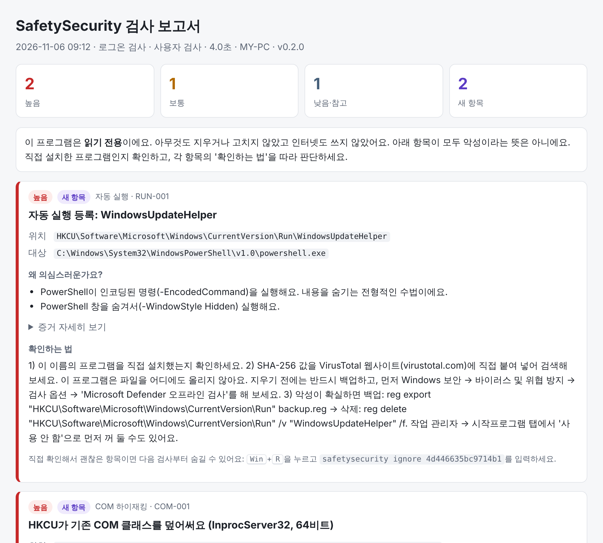

<p align="center">
  <picture>
    <source media="(prefers-color-scheme: dark)" srcset="docs/assets/banner-dark.svg">
    
  </picture>
</p>

<p align="center">
  <a href="https://github.com/jiyul-me/safety-security/actions/workflows/ci.yml"></a>
  <a href="LICENSE"></a>
  
  
  
  
</p>

<p align="center">
  <b>악성코드가 PC에 몰래 남겨 두는 "자동 실행 흔적"을 찾아서 알려주는 읽기 전용 검사기</b><br>
  아무것도 지우거나 고치지 않고, 인터넷도 쓰지 않습니다. 게임 중에는 조용히 기다립니다.
</p>

<p align="center">
  <a href="#빠른-시작">빠른 시작</a> ·
  <a href="#검사-항목">검사 항목</a> ·
  <a href="docs/DETECTIONS.md">탐지 규칙</a> ·
  <a href="docs/TESTING-ON-YOUR-PC.md">PC에서 시험하기</a> ·
  <a href="docs/ARCHITECTURE.md">구조</a> ·
  <a href="CONTRIBUTING.md">기여하기</a> ·
  <a href="README.en.md">English</a>
</p>

---

> **만든 계기**: 한 게임 PC 런처가 해킹됐을 때 악성코드가 `HKCU\Software\Classes\CLSID\{…}\InprocServer32`에 몰래 등록되어
> Chrome이 악성 DLL을 불러오게 만든 일이 있었습니다 (COM 하이재킹, MITRE ATT&CK [T1546.015](https://attack.mitre.org/techniques/T1546/015/)).
> 이런 등록은 관리자 권한 없이도 만들 수 있고 눈에 잘 띄지 않습니다. SafetySecurity는 이런 흔적을 주기적으로 확인합니다.

## 빠른 시작

PowerShell은 필요 없습니다.

1. [Releases](https://github.com/jiyul-me/safety-security/releases/latest)에서 **`SafetySecurity-Setup-x.y.z.exe`** 를 받습니다.
2. 받은 파일을 더블클릭합니다. "Windows의 PC 보호" 창이 뜨면 **추가 정보 → 실행**을 누릅니다 ([창이 뜨는 이유](#설치)).
3. 설치 방식을 고릅니다.
   - **내 계정에만** (권장): 권한 요청 없이 바로 설치됩니다.
   - **관리자 권한으로**: Defender 제외 목록, 숨겨진 예약 작업, WMI 구독까지 검사합니다. 권한 요청 창이 뜹니다. 관리자 계정으로 로그인했을 때만 고릅니다 ([이유](#한계-꼭-읽을-것)).
4. 추가 작업 화면의 **바탕화면 바로가기 만들기**는 기본으로 켜져 있습니다. 필요 없으면 끕니다.
5. 마지막 화면에서 **지금 첫 검사하기**를 켜 둔 채 마침을 누르면, 검사가 끝난 뒤 보고서가 열립니다.

> 설치 프로그램은 v0.2.0부터 있습니다. 그 전 버전은 아래 [명령줄로 설치하기](#설치)를 참고해 주세요.
>
> v0.1.0을 zip으로 `install --admin` 해서 쓰고 있었다면, 설치 방식에서 **관리자 권한으로**를 고릅니다. '내 계정에만'을 고르면 예전 관리자 검사 작업이 남아서 옛 exe로 계속 실행됩니다.

> [!WARNING]
> **스마트 앱 컨트롤**(Smart App Control)이 켜진 PC에는 아직 설치할 수 없습니다. 설치 프로그램과 exe에 코드 서명이 없어서 Windows가 실행을 막습니다 (SmartScreen 창과 달리 '실행' 버튼이 없습니다).
> 켜져 있는지는 Windows 보안 → 앱 및 브라우저 컨트롤 → 스마트 앱 컨트롤 설정에서 볼 수 있습니다.
> 이 프로그램을 쓰려고 스마트 앱 컨트롤을 **끄는 것은 권장하지 않습니다.** Windows 버전에 따라 한 번 끄면 Windows를 새로 설치(초기화)하기 전에는 다시 켤 수 없습니다.

그다음부터는 신경 쓸 필요가 없습니다. 로그온할 때, 하루 한 번, 새 서비스가 설치될 때 알아서 잠깐 검사하고, 새로운 의심 항목이 있을 때만 알림을 띄웁니다.

| 하고 싶은 것 | 방법 |
|---|---|
| 지금 검사하기 | 바탕화면이나 시작 메뉴의 **SafetySecurity** (검사하는 동안 알림이 뜨고, 끝나면 보고서가 열립니다) |
| 괜찮은 항목 숨기기 | 보고서에 적힌 대로 <kbd>Win</kbd>+<kbd>R</kbd> → `safetysecurity ignore <ID>` (항목의 위험도와 제목을 보여 주고 한 번 더 묻습니다) |
| 숨긴 항목 보기·되돌리기 | <kbd>Win</kbd>+<kbd>R</kbd> → `safetysecurity ignored`, 되돌리려면 `safetysecurity unignore <ID>` |
| 상태 보기 | <kbd>Win</kbd>+<kbd>R</kbd> → `safetysecurity status` (마지막 검사, 미뤄둔 검사, 등록된 작업, 알림이 켜져 있는지) |
| 제거하기 | 설정 → 앱 → 설치된 앱 → **SafetySecurity** → 제거 (예약 작업까지 지웁니다) |

<p align="center">
  <picture>
    <source media="(prefers-color-scheme: dark)" srcset="docs/assets/report-dark.png">
    
  </picture>
  <br><sub>보고서 예시 (<a href="docs/sample-report.html">sample-report.html</a>). 항목마다 이유, 증거, 직접 확인하는 법이 있습니다.</sub>
</p>

## 특징

| | |
|---|---|
| **평소에는 꺼져 있습니다** | 상주 프로세스가 없습니다. Windows 작업 스케줄러가 로그온, 하루 한 번, 새 서비스 설치 때 깨우면 검사하고 바로 끝납니다. |
| **게임을 방해하지 않습니다** | 전체 화면 게임, 게임 프로세스, 높은 CPU 사용률이 보이면 검사를 미루고 30분 뒤에 다시 확인합니다. 검사 중에 게임이 시작돼도 멈춥니다. 하루 넘게 밀린 검사도 목록의 게임이 켜져 있는 동안에는 하지 않고, 밀렸다고 한 번 알려 드립니다. |
| **가볍습니다** | 자기 프로세스만 백그라운드 모드(낮은 CPU·디스크 우선순위)와 효율 모드로 돌리고, 한 줄로(단일 스레드) 천천히 검사합니다. 서명 확인 결과를 캐시해서 두 번째 검사부터는 훨씬 빠릅니다. |
| **안티치트(뱅가드 등)와 충돌하지 않습니다** | 커널 드라이버, 다른 프로세스 열기(`OpenProcess`), 메모리 접근, 코드 주입, 후킹을 **전혀** 쓰지 않습니다. 실행 중인 프로그램은 핸들을 열지 않는 스냅샷으로 이름만 봅니다. 제한 시간을 넘긴 `schtasks`·`powershell`도 자기가 띄운 그 프로세스 하나만 끝냅니다. |
| **읽기 전용** | 레지스트리는 읽기 권한으로만, 파일은 읽기 모드로만 엽니다. 고치는 방법은 보고서에 적어 드릴 뿐, 실제 수정은 사용자가 직접 합니다. |
| **오프라인** | 네트워크 코드가 없습니다. 서명 확인 때 인증서 폐기 확인(CRL/OCSP)도 꺼 두었습니다. 자동 실행 항목이 공유 폴더·WebDAV·네트워크 드라이브의 파일을 가리켜도 열지 않고 경로만으로 판단합니다. |
| **스스로를 지킵니다** | SafetySecurity 이름을 흉내 낸 예약 작업과 꺼진 SafetySecurity 작업을 알립니다. 관리자 검사는 관리자만 바꿀 수 있는 폴더에 설정·기록을 두고, 자기가 띄우는 Windows 도구에 사용자 환경 변수를 넘기지 않습니다. |

이 약속들은 말로만 하는 것이 아니라 코드로 강제됩니다.

- [`BannedSymbols.txt`](BannedSymbols.txt): 네트워크, 레지스트리 쓰기, 파일 삭제, 다른 프로세스 접근 API를 쓰면 **빌드가 실패**합니다.
- [`ForbiddenApiTests.cs`](tests/SafetySecurity.Core.Tests/ForbiddenApiTests.cs): `OpenProcess`, `WriteProcessMemory`, `SetWindowsHookEx` 같은 Win32 함수를 선언하면 **테스트가 실패**합니다.

## 검사 항목

규칙 ID별 자세한 설명은 [docs/DETECTIONS.md](docs/DETECTIONS.md)에 있습니다.

| 분류 | 보는 곳 | 특히 위험하게 보는 경우 |
|---|---|---|
| **COM 하이재킹** | `HKCU\Software\Classes\CLSID` (64·32비트)의 `InprocServer32`, `LocalServer32`, `TreatAs`, `ScriptletURL` | HKCU 항목이 같은 CLSID의 HKLM 항목을 **덮어쓰면서** 서명 없는 DLL이나 사용자 폴더의 DLL을 가리킴, 최근 7일 안에 생긴 키 |
| 자동 실행 | Run/RunOnce 키, 시작프로그램 폴더(.lnk 대상 분석), Winlogon `Shell`/`Userinit`, `AppInit_DLLs`, `AppCertDlls`, IFEO 디버거, SilentProcessExit, 로그온 스크립트, cmd AutoRun | `powershell -enc`, `mshta`, `rundll32 javascript:` 같은 악용 패턴, 임시 폴더의 서명 없는 실행 파일. `cmd /c`·`start`·PowerShell `Start-Process` 등으로 감싼 명령은 **실제로 실행되는 파일**로 판단하고, 보이는 대상과 실제 대상이 다른 바로가기도 알립니다 |
| 서비스·드라이버 | `HKLM\SYSTEM\CurrentControlSet\Services`의 `ImagePath`, `ServiceDll` | 사용자 폴더의 드라이버·서비스 DLL, 따옴표 없는 경로 |
| 예약 작업 | `schtasks /query /xml`로 조회 | 숨김 작업 + 사용자 폴더 실행 파일, LOLBin 악용, SafetySecurity 이름을 흉내 낸 작업 |
| 숨겨진 작업 (관리자) | `TaskCache\Tree` | 보안 설명자(SD)가 지워진 작업 (Tarrask 수법) |
| 브라우저 | Chrome·Edge·Brave·Whale 정책, 시스템 프록시, 브라우저 바로가기 | 강제 설치 확장 프로그램, `--load-extension`·원격 디버깅 인자 |
| Defender | 끄기 정책, 제외 목록 (로컬 제외 목록은 관리자) | 사용자 폴더·실행 파일 확장자 전체 제외 |
| hosts 파일 | `drivers\etc\hosts` | 보안·업데이트·게임 사이트 차단이나 다른 IP로 보내기 (텔레메트리·광고 주소만 막은 줄은 참고) |
| **디스코드** | `%LOCALAPPDATA%`의 Discord·PTB·Canary·Development 앱의 `discord_desktop_core\index.js` | 토큰 탈취 악성코드가 고친 시작 파일 (게임 치트·크랙 파일로 많이 퍼집니다). BetterDiscord는 '낮음' |
| WMI 구독 (관리자) | `root\subscription` | CommandLine/ActiveScript consumer |
| 새 실행 파일 | AppData, LocalAppData, Temp, ProgramData, Public (바로 아래 + 1단계) | 최근 14일 안에 생긴 서명 없는 실행 파일, `invoice.pdf.exe` 같은 이중 확장자, 확장자를 속인 실행 파일 |

**오탐을 줄이는 방법**
- 유효한 디지털 서명이 있으면 위험도를 낮춥니다 (Windows 카탈로그 서명도 확인합니다).
- 첫 검사 결과를 **베이스라인**으로 저장합니다. 그 뒤로는 *새로 생긴* 항목만 알림을 띄웁니다. 첫 검사에서는 이미 감염됐을 때를 대비해 '높음'만 알립니다 (새 버전에 생긴 분류를 처음 검사할 때도 같습니다).
- 같은 자리의 항목이라도 더 위험해지거나 그 뒤의 파일이 바뀌면(서명, 서명자, SHA-256) '달라진 항목'으로 다시 알립니다.
- 직접 확인해서 괜찮은 항목은 숨길 수 있습니다. 방법은 보고서의 항목마다 적혀 있습니다 (설치 프로그램으로 설치했다면 <kbd>Win</kbd>+<kbd>R</kbd> → `safetysecurity ignore <ID>`). 숨김은 숨길 때의 상태에 묶여서, 그 뒤로 더 위험해지거나 파일이 바뀌면 다시 보여 드립니다.

## 설치

**설치 프로그램 (권장)**: [빠른 시작](#빠른-시작)대로 `SafetySecurity-Setup-x.y.z.exe`를 실행하면 됩니다.
설치 프로그램은 실행 파일을 아래 위치에 두고 시작 메뉴·바탕화면(선택, 기본으로 켜짐)·앱 목록에 등록합니다. 작업 스케줄러 등록은 `SafetySecurity.exe install`이 맡습니다.

| 설치 방식 | 실행 파일 위치 | 권한 요청 |
|---|---|---|
| 내 계정에만 | `%LOCALAPPDATA%\Programs\SafetySecurity` | 없음 |
| 관리자 권한으로 | `C:\Program Files\SafetySecurity` | UAC 창 |

설치 프로그램을 다시 실행하면 묻지 않고 **같은 방식으로 업데이트**합니다. 설치 방식을 바꾸려면('내 계정에만' ↔ '관리자 권한으로') 설정 → 앱에서 먼저 제거한 뒤 다시 설치하고 방식을 고릅니다.
명령줄의 `/ALLUSERS`·`/CURRENTUSER`로도 설치 방식을 바꿀 수 없습니다. 다른 방식으로 설치된 것이 있으면 설치 프로그램이 아무것도 바꾸지 않고 멈춥니다 (두 개가 함께 있으면 한쪽을 제거할 때 다른 쪽의 자동 검사까지 지워지기 때문입니다).
'내 계정에만' 설치를 제거할 때 "검사 기록과 보고서도 지울까요?"에 **아니요**를 고르면 검사 기록이 남아서 이어서 씁니다.

**받은 파일이 진짜인지 확인하기 (권장)**
```powershell
Get-FileHash .\SafetySecurity-Setup-x.y.z.exe -Algorithm SHA256   # SHA256SUMS.txt와 비교
gh attestation verify .\SafetySecurity-Setup-x.y.z.exe --repo jiyul-me/safety-security
# 설치된 실행 파일도 확인할 수 있습니다 (관리자 설치면 C:\Program Files\SafetySecurity\SafetySecurity.exe)
gh attestation verify "$env:LOCALAPPDATA\Programs\SafetySecurity\SafetySecurity.exe" --repo jiyul-me/safety-security
```

> 코드 서명 인증서가 아직 없어서 처음 실행할 때 SmartScreen 경고("Windows의 PC 보호")가 뜹니다.
> '추가 정보' → '실행'을 누르면 됩니다. 위의 해시·출처 증명으로 파일이 진짜인지 먼저 확인해 주세요.
> 같은 이유로 **스마트 앱 컨트롤**이 켜진 PC에는 아직 설치할 수 없습니다 ([빠른 시작](#빠른-시작)의 경고 참고). 무료 오픈소스 코드 서명은 따로 검토하고 있습니다.

<details>
<summary><b>명령줄로 설치하기 (zip)</b></summary>

1. Releases에서 `SafetySecurity-x.y.z-win-x64.zip`을 받아 압축을 풀고, PowerShell에서 그 폴더로 이동합니다 (`cd ` 뒤에 폴더를 끌어다 놓아도 됩니다).
2. 설치합니다. 실행 파일을 위 표의 위치로 복사하고 작업을 등록합니다.
   ```powershell
   .\SafetySecurity.exe install           # 내 계정에만
   .\SafetySecurity.exe install --admin   # 관리자 검사도 추가 (UAC 창이 뜹니다)
   ```
3. 제거할 때는 `.\SafetySecurity.exe uninstall`(관리자 설치였다면 관리자 PowerShell)을 실행하고, 위 표의 폴더를 지웁니다. 관리자 PowerShell에서 실행한 `uninstall --purge`는 관리자 검사 기록(`C:\Program Files\SafetySecurity\data`)만 지우고, 내 계정의 `%LOCALAPPDATA%\SafetySecurity`는 남깁니다.

</details>

**관리자 권한으로 설치하면 좋은 점**
- 실행 파일이 `Program Files`에 들어가서, 일반 권한 악성코드가 검사기 자체를 바꿔치기하기 어려워집니다.
- 관리자 검사의 설정·기록·보고서도 관리자만 바꿀 수 있는 `C:\Program Files\SafetySecurity\data`에 둡니다.
- Defender 로컬 제외 목록, 숨겨진 예약 작업, WMI 구독처럼 관리자만 읽을 수 있는 항목도 확인합니다.

설치하면 작업 스케줄러의 `\SafetySecurity\` 폴더에 아래 작업이 생깁니다.

| 작업 | 언제 | 하는 일 |
|---|---|---|
| `Logon` | 로그온 3분 뒤 | 전체 검사 (2시간 안에 전체 검사를 끝냈고 미뤄둔 검사가 없으면 건너뜁니다) |
| `Daily` | 하루 한 번 (꺼져 있었으면 켜진 뒤) | 전체 검사 (`Logon`과 마찬가지로 2시간 안이면 건너뜁니다) |
| `ServiceInstalled` | 새 서비스 설치 (System 로그 이벤트 7045) | 서비스·예약 작업만 빠르게 검사 |
| `Retry` | 30분마다 | 미뤄둔 검사(게임 때문에 미룬 검사, 다른 검사와 겹친 검사)가 있을 때만 검사, 없으면 0.1초 안에 종료 |
| `Admin` (관리자 설치만) | 로그온 + 30분마다 확인, 하루 한 번 | 관리자 전용 항목 검사 |
| `ServiceInstalledAdmin` (관리자 설치, 예비) | 새 서비스 설치 (이벤트 7045) | `ServiceInstalled`를 등록하지 못한 PC에만 만듭니다. 서비스와 숨겨진 예약 작업을 관리자 권한으로 빠르게 검사 |

모든 작업은 우선순위 7(낮음), 최대 15분 제한, 중복 실행 안 함으로 설정됩니다. 자동 검사가 다른 검사와 겹치면 버리지 않고 미뤄둔 검사로 남겨 두고, `Retry`가 처리합니다.
게임·전체 화면·CPU 때문에 미뤄둔 검사가 하루(24시간)를 넘으면, CPU·전체 화면 때문에는 더 미루지 않고 낮은 우선순위로 검사합니다 (6시간에 한 번까지). 목록의 게임이 켜져 있으면 그래도 검사하지 않고 "검사가 밀렸어요" 알림을 한 번 띄웁니다.

## 사용법

```
SafetySecurity.exe                    지금 검사하고 보고서 열기 (더블클릭·바탕화면·시작 메뉴와 같습니다)
SafetySecurity.exe scan --force       게임 중이어도 지금 검사
SafetySecurity.exe status             마지막 검사, 미뤄둔 검사, 등록된 작업, 알림 설정
SafetySecurity.exe report             마지막 보고서 열기
SafetySecurity.exe ignore <ID>        항목 숨기기 (ID는 보고서에 있습니다. 앞 8자리 이상만 적어도 됩니다)
SafetySecurity.exe ignored            숨긴 항목 목록 (사용자·관리자 검사 모두)
SafetySecurity.exe unignore <ID>      숨긴 항목을 다시 보이게 하기
SafetySecurity.exe verify <파일>      파일 하나의 디지털 서명 확인 (네트워크 경로는 거절합니다)
SafetySecurity.exe test-notify        알림이 뜨는지 시험
SafetySecurity.exe help               도움말 (--help, -h, /?도 됩니다)
SafetySecurity.exe uninstall [--purge]
```

첫 인자는 항상 명령입니다. 모르는 옵션(예: `--foo`)을 주면 검사를 시작하지 않고 도움말을 보여 줍니다. 인자 없이 실행할 때만 바로 검사합니다.
`ignore`는 최근 검사 기록이나 보고서에 있는 ID만 받습니다. 오타나 모르는 ID는 아무것도 저장하지 않고 거절하고, `--scope`를 적지 않아도 관리자 검사 항목을 스스로 찾습니다 (그 항목은 관리자 권한을 요청합니다).

설치 프로그램으로 설치했다면 PowerShell 없이 <kbd>Win</kbd>+<kbd>R</kbd>에서 `safetysecurity status`처럼 실행할 수 있습니다. 결과는 메시지 창으로 보여 줍니다. Win+R로 실행한 `scan`(예: `safetysecurity scan --force`)도 바탕화면 아이콘처럼 "검사하고 있어요" 알림을 띄우고, 끝나면 보고서를 엽니다.
직접 시작한 검사(인자 없는 실행, 바탕화면·시작 메뉴, `scan --force`)는 최대 30분 동안 진행합니다 (자동 검사는 12분). 너무 오래 걸려 멈추면 그렇다고 알려 드리고, 남은 검사는 `Retry` 작업이 백그라운드에서 마저 합니다.

의심 항목이 있으면 Windows 알림이 뜨고, 누르면 HTML 보고서가 열립니다. 보고서에는 항목마다 아래 내용이 있습니다.
- **왜 의심스러운지**
- **증거**: 서명 상태, 서명자, SHA-256, 파일·레지스트리 키가 만들어지거나 바뀐 시각
- **직접 확인하는 법**: VirusTotal에 해시 검색하기(검색은 직접 하며, 프로그램은 아무것도 올리지 않습니다), 백업 명령(`reg export`), 끄거나 지우는 명령

Windows 알림이 꺼져 있으면(이 앱만, 모든 앱, 회사·학교 정책) 보고서의 '확인하지 못한 것'과 `status`가 알려 주고 켜는 법(설정 → 시스템 → 알림)을 안내합니다. 집중 지원(방해 금지) 상태는 알 수 없습니다.

보고서와 기록은 데이터 폴더에 있습니다 (`reports\`, `logs\scan.log`, `config.json`, `state*.json`).

| 누가 실행했는지 | 데이터 폴더 |
|---|---|
| 일반 권한 (자동 검사 작업, 바탕화면·시작 메뉴, Win+R) | `%LOCALAPPDATA%\SafetySecurity\` |
| 관리자 권한 (`Admin` 작업, 관리자 설치·제거, 관리자 PowerShell, UAC를 끈 PC) | `C:\Program Files\SafetySecurity\data\` (관리자만 바꿀 수 있습니다) |

관리자 검사는 자기 `config.json`과 숨김 목록을 따로 씁니다. 일반 사용자도 그 보고서는 읽을 수 있지만, 관리자 검사의 게임 목록·알림 기준·숨김 목록은 관리자만 바꿀 수 있습니다. `status`는 두 곳을 모두 보여 줍니다. 예전 버전이 `%LOCALAPPDATA%\SafetySecurity`에 남긴 `state.admin.json`·`sigcache.admin.json`은 더 이상 쓰지 않으므로 지워도 됩니다.

### 설정 (`config.json`)

```json
{
  "gameProcesses": ["VALORANT-Win64-Shipping.exe", "League of Legends.exe", "..."],
  "notifyMinSeverity": "Medium",
  "cpuBusyPercent": 60,
  "deferOnFullscreen": true
}
```

## 한계 (꼭 읽을 것)

- **백신이 아닙니다.** 파일 내용을 악성코드 시그니처와 비교하지 않습니다. Windows Defender 같은 백신과 *함께* 쓰는 도구입니다.
- 결과는 "의심"이지 "확정"이 아닙니다. 정상 프로그램도 걸릴 수 있고, 아주 정교한 악성코드는 못 찾을 수도 있습니다.
- 일반 사용자 설치에서는 같은 권한의 악성코드가 검사기 파일이나 기록(`%LOCALAPPDATA%\SafetySecurity`)을 바꿀 수 있습니다. 그래서 관리자 설치를 권장합니다. 관리자 설치는 실행 파일과 관리자 검사 기록을 관리자만 바꿀 수 있는 `C:\Program Files\SafetySecurity`에 둡니다.
- **표준(일반) 계정**에서 '관리자 권한으로'를 고르고 다른 관리자 계정의 비밀번호를 넣으면, 자동 검사 작업이 그 관리자 계정으로 등록되어 지금 계정에서는 실행되지 않습니다. 표준 계정이라면 '내 계정에만'을 고릅니다.
- 커널 루트킷처럼 Windows 자체를 속이는 악성코드는 사용자 모드 도구로는 찾기 어렵습니다. 의심되면 Microsoft Defender 오프라인 검사를 실행해 주세요.
- 알려진 한계 전체는 [SECURITY.md](SECURITY.md#알려진-한계)에 모아 두었습니다.

## 직접 빌드하기

필요한 것: [.NET 10 SDK](https://dotnet.microsoft.com/download)

```bash
dotnet build SafetySecurity.slnx           # macOS·Linux에서도 됩니다
dotnet test tests/SafetySecurity.Core.Tests # 규칙 테스트 (macOS·Linux에서도 됩니다)
```

Windows에서 NativeAOT 단일 exe 만들기 (Visual Studio의 "C++를 사용한 데스크톱 개발" 구성 요소가 필요합니다):

```powershell
dotnet publish src/SafetySecurity -c Release -r win-x64 -o out
pwsh tests/integration/Run-Integration.ps1 -Exe out/SafetySecurity.exe   # 통합 테스트 (HKCU에 가짜 항목을 만들었다가 지웁니다)
```

macOS에서 Windows용 exe를 만들고 싶으면 NativeAOT 대신 이렇게 합니다 (파일은 조금 더 크지만 기능은 같습니다).

```bash
dotnet publish src/SafetySecurity -c Release -r win-x64 -p:PublishAot=false --self-contained -p:PublishSingleFile=true -o out
```

### 프로젝트 구조

```
src/SafetySecurity.Core/   규칙·스캐너·보고서 (Windows API 없음, 어디서나 테스트 가능)
src/SafetySecurity/        Windows 연결부: 레지스트리, 서명 확인(WinVerifyTrust), 게임 감지, 작업 스케줄러, 알림
tests/                     단위 테스트 (가짜 레지스트리·파일 시스템), Windows 통합 테스트
installer/                 설치 프로그램 (Inno Setup 스크립트)
tools/Test-OnMyPC.ps1      내 PC에서 안전하게 시험하는 안내형 스크립트
docs/                      탐지 규칙, 구조, 시험 안내, 저장소 관리
```

자세한 구조는 [docs/ARCHITECTURE.md](docs/ARCHITECTURE.md), 기여 방법과 브랜치 전략은 [CONTRIBUTING.md](CONTRIBUTING.md)를 참고해 주세요.

### 내 PC에서 시험하기

안내형 스크립트 `tools/Test-OnMyPC.ps1`이 가짜 항목을 만들어 탐지를 확인하고 반드시 지웁니다. 순서는 [docs/TESTING-ON-YOUR-PC.md](docs/TESTING-ON-YOUR-PC.md)에 있습니다.

## 라이선스

[MIT](LICENSE) · 보안 문제 신고는 [SECURITY.md](SECURITY.md) · [행동 강령](CODE_OF_CONDUCT.md) · [변경 기록](CHANGELOG.md)
