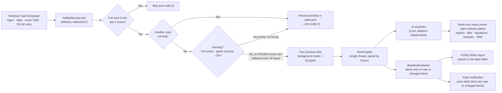

# Architecture

[한국어](ARCHITECTURE.md) · **English**

## Two projects

| Project | Target | Responsibilities |
|---|---|---|
| `src/SafetySecurity.Core` | `net10.0` (anywhere) | Models, path classification, command-line analysis, `.lnk`/PE/task XML parsers, **11 scanners**, baseline, scan scheduling rules, reports. It does not call Windows APIs directly, so it can be tested on macOS and Linux. |
| `src/SafetySecurity` | `net10.0-windows`, NativeAOT | Windows implementations of the interfaces Core uses (`IRegistryView`, `IFileSystemView`, `ISignatureVerifier`, `ITaskSource`, `IWmiSource`), game detection, throttling, task registration, notifications, command line |

Scanners implement `IScanner` and receive only read-only tools through `ScanContext`. Tests plug in `FakeRegistry` and `FakeFileSystem` to verify rules without a real Windows machine.
`ScanContext` always wraps the file view and signature verifier it is given in `LocalOnlyFileSystemView` and `LocalOnlySignatureVerifier`, so no scanner can open a network path.

## Key files

| File | Description |
|---|---|
| `Core/Scanners/ComHijackScanner.cs` | Compares HKCU CLSIDs against HKLM (core rule) |
| `Core/Scanners/DiscordScanner.cs` | Tampering with Discord's `discord_desktop_core\index.js` (`DISC-001`/`DISC-002`). Reads only the folder listing and two files of 1 MB or less, and does not follow links |
| `Core/Scanners/ScheduledTaskScanner.cs` | Scheduled tasks. Tasks using the SafetySecurity name are checked by name, executable and arguments (`TASK-003`/`TASK-004`) |
| `Core/Rules/ExecutableAssessor.cs` | Assesses a single file: location, signature, recency, hidden attribute. Network paths are assessed by path alone, never opened |
| `Core/Rules/CommandAssessor.cs`, `CommandLineHeuristics.cs` | Command line → executable and payload, LOLBin abuse patterns, PowerShell switch parsing |
| `Core/Rules/LauncherCommands.cs` | Unwraps `cmd /c`, `start`, `conhost`, `forfiles`, `pcalua`, `wmic`, PowerShell `Start-Process` and similar to find the command that actually runs (up to 3 levels deep) |
| `Core/Rules/ShortcutTargets.cs`, `Core/Parsing/LnkParser.cs` | Resolves shortcut targets in the same order Windows does (environment variable block → IDList → LinkInfo → relative path) |
| `Core/Abstractions/LocalOnly.cs` | File and signature views that block network paths (`\\server\share`, `\\?\UNC\…`, WebDAV, network drives) |
| `Core/Baseline/BaselineEvaluator.cs`, `FindingFingerprint.cs` | Decides what is new or changed (higher risk; changed signature, signer or SHA-256) and which findings to alert on |
| `Core/Baseline/IgnoreList.cs` | Ignore list: ID lookup (8+ leading characters), records state at the time of ignoring, preserves ignore changes made during a scan |
| `Core/Baseline/ScanSchedule.cs` | When to scan and when to defer (just scanned, overlapping scan, deferred over 24 hours) |
| `Core/Install/OwnTasks.cs` | Names and arguments of our own scheduled tasks. Shared by `TaskXmlBuilder`, `TaskInstaller` and `ScheduledTaskScanner` |
| `Core/Install/SelfExecutables.cs` | Exe paths treated as "the scanner itself" (admin scans do not trust paths a user can modify) |
| `Core/Install/DataRoots.cs` | Data folder locations (standard / elevated) |
| `Core/Install/ChildEnvironment.cs` | Minimal environment variables passed to child processes |
| `Core/Reporting/HtmlReport.cs` | Self-contained report with no external resources, scripts blocked by CSP, every value HTML-encoded |
| `SafetySecurity/Windows/AuthenticodeVerifier.cs` | `WinVerifyTrust` + catalogs, revocation checks off (offline), network paths rejected |
| `SafetySecurity/Windows/ChildProcess.cs` | Runs `schtasks.exe` and `powershell.exe` by full System32 path with a minimal environment. On timeout, terminates only that one process |
| `SafetySecurity/Windows/NetworkDrives.cs` | Finds network drive letters (`GetLogicalDrives` + `QueryDosDevice`; reads only this PC's drive letter mappings) |
| `SafetySecurity/Runtime/GameDetector.cs` | Game detection without opening process handles |
| `SafetySecurity/Runtime/DataStore.cs` | Reads and writes the data folder (write to a temp file, then swap) |
| `SafetySecurity/Runtime/Throttle.cs` | Background mode, scan lock (`ScanLock`), state file lock (`StateLock`) |
| `SafetySecurity/Install/TaskInstaller.cs` | Registers task XML (generated by `Core/Install/TaskXmlBuilder.cs`) |
| `installer/SafetySecurity.iss` | Installer (Inno Setup). Handles only files, the Start menu, the desktop shortcut (optional task `desktopicon`, on by default), the Apps list and the Win+R name (App Paths); task registration is left to `install --quiet` / `uninstall --quiet`. Stops if the app is already installed by another method. Uninstalling an admin install also deletes `{app}\data`. The install folder matches `TaskInstaller`. `AppId` is fixed |

## Safeguards

1. **Build time**: `BannedSymbols.txt` + `Microsoft.CodeAnalysis.BannedApiAnalyzers` → using a banned API is an `RS0030` build error.
   The only exceptions are `Runtime/DataStore.cs` (its own data folder) and `Install/TaskInstaller.cs` (an install the user runs directly).
   `Process.Kill(bool)`, which kills a whole process tree, is also banned (it opens every process).
2. **Test time**: `ForbiddenApiTests` checks every `[LibraryImport]` in the source and blocks `OpenProcess`, `WriteProcessMemory`, `SetWindowsHookEx`, `ws2_32`, `wininet` and others. The list of exempt files is pinned as well.
3. **Run time**: The registry is opened only with `KEY_READ`, and files only with `FileAccess.Read` plus sharing. The manifest is `asInvoker`, so the app never elevates itself. Network paths are blocked by the `LocalOnly` views.
4. **Child processes**: `schtasks.exe` and `powershell.exe` run by full System32 path, without inheriting the user's environment variables, using the minimal environment built by `ChildEnvironment` (`PSModulePath` is pinned to the system module folder). On timeout, only that one process is terminated, using the handle already held.
5. **Elevation**: An elevated process does not use a user-writable data folder (`DataRoots`) and does not treat a user-modifiable exe as "the scanner itself" (`SelfExecutables`).

## Data folder

| Who ran it | Data folder |
|---|---|
| Standard (user task, desktop/Start menu, Win+R) | `%LOCALAPPDATA%\SafetySecurity\` |
| Elevated (`Admin`/`ServiceInstalledAdmin` tasks, `install --admin`, admin install/uninstall, elevated shell, PC with UAC off) | `C:\Program Files\SafetySecurity\data\` (inherits Program Files permissions, so only administrators can modify it) |

`--data-dir <folder>` redirects both to that folder (for testing). An elevated process never reads or writes `%LOCALAPPDATA%\SafetySecurity`.
`status` reads the admin data folder (read-only) even from a standard process, so it can show the admin scan status. To change admin scan items with `ignore`/`unignore`, run it again elevated (UAC).

| File | Contents |
|---|---|
| `state.json`, `state.admin.json` | Last scan, deferred scan, baseline, ignore list (see below) |
| `sigcache*.json` | Signature check cache (path + size + modified time, 30 days) |
| `config.json` | Game list, alert threshold, CPU threshold. One per data folder. If missing, it is created with defaults when a scan finishes |
| `reports\` | The 30 most recent reports (HTML + JSON) |
| `logs\scan.log` | Scan log (rotated at 1 MB). Also records deferred, skipped and overlapping scans |

### State file (`state*.json`)

Version 2 keeps all version 1 fields as they are and only adds new ones. Every new field is optional, so older versions can read new files and newer versions can read old files.

| Field | Contents |
|---|---|
| `baseline`, `ignored` | (Version 1) Finding IDs seen in the last scan → category; ignored finding IDs |
| `baselineDetail` | Finding ID → risk level at the time, file fingerprint (signature status, signer, first 16 characters of SHA-256), title. Kept so that an item in the same place is re-alerted if it becomes riskier or the file changes |
| `ignoredDetail` | Ignored finding ID → title, category, time, risk level and file fingerprint at the time it was ignored. If it later becomes riskier or the file changes, it is shown again |
| `initializedCategories` | Categories that have been fully scanned at least once. Categories not listed here alert only on "높음" ("High"), as on a first scan |
| `pending` | Deferred scan. `requestedUtc` (first request), `overdueRunUtc` (when an overdue scan ran in the background), `overdueNoticeUtc` (when the user was told the scan was overdue) |

Saving the state file and running `ignore`/`unignore` take a short lock on a per-file named mutex (`Local\SafetySecurity.State.<hash>`) and do a read-modify-write. When a scan saves, it re-reads the file so that ignore-list changes made during the scan are preserved.

A category that was only partly read (task list unreadable, broken task XML, etc.) is shown in the report as "(일부만 확인)" ("partially checked"), and its existing baseline items are not removed. That way, when it is read properly next time, the same items are not alerted again as new.

## Scheduled task names and arguments

Task names and arguments live in one place: `src/SafetySecurity.Core/Install/OwnTasks.cs`. `ScheduledTaskScanner` treats only tasks that exactly match these values as SafetySecurity tasks, so if you change the arguments, also update `$ownArgs` in `tools/Test-OnMyPC.ps1`.

## Known limitations

Issues we know about but have not fixed yet (admin install from a standard account, admin tasks left over when upgrading from a v0.1.0 zip install, .NET user settings in elevated PowerShell, Discord folder links, etc.) are collected in [SECURITY.en.md](../SECURITY.en.md#known-limitations).
