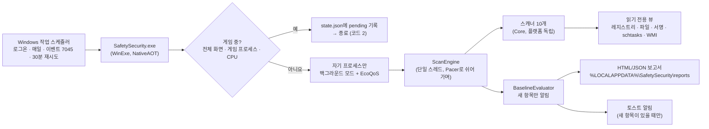

# 구조 / Architecture

## 두 개의 프로젝트

| 프로젝트 | 대상 | 하는 일 |
|---|---|---|
| `src/SafetySecurity.Core` | `net10.0` (어디서나) | 모델, 경로 분류, 명령줄 분석, `.lnk`·PE·작업 XML 파서, **스캐너 10개**, 베이스라인, 보고서. Windows API를 직접 쓰지 않아서 macOS·Linux에서도 테스트할 수 있어요. |
| `src/SafetySecurity` | `net10.0-windows`, NativeAOT | Core가 쓰는 인터페이스(`IRegistryView`, `IFileSystemView`, `ISignatureVerifier`, `ITaskSource`, `IWmiSource`)의 Windows 구현, 게임 감지, 부하 조절, 작업 등록, 알림, 명령줄 |

스캐너는 `IScanner`를 구현하고 `ScanContext`로 읽기 전용 도구만 받아요. 그래서 테스트에서는 `FakeRegistry`·`FakeFileSystem`을 넣어 실제 Windows 없이 규칙을 검증해요.

## 주요 파일

| 파일 | 설명 |
|---|---|
| `Core/Scanners/ComHijackScanner.cs` | HKCU CLSID ↔ HKLM 비교 (핵심 규칙) |
| `Core/Rules/ExecutableAssessor.cs` | 파일 하나 평가: 위치, 서명, 최근 여부, 숨김 속성 |
| `Core/Rules/CommandAssessor.cs`, `CommandLineHeuristics.cs` | 명령줄 → 실행 파일·페이로드, LOLBin 악용 패턴 |
| `Core/Baseline/BaselineEvaluator.cs` | 새 항목 판단, 알림 대상 선택 |
| `Core/Reporting/HtmlReport.cs` | 외부 리소스 없는 보고서, CSP로 스크립트 차단, 모든 값 HTML 인코딩 |
| `SafetySecurity/Windows/AuthenticodeVerifier.cs` | `WinVerifyTrust` + 카탈로그, 폐기 확인 끔(오프라인) |
| `SafetySecurity/Runtime/GameDetector.cs` | 핸들을 열지 않는 게임 감지 |
| `SafetySecurity/Install/TaskInstaller.cs` | 작업 XML 등록 (`Core/Install/TaskXmlBuilder.cs`가 생성) |

## 안전장치

1. **빌드 시간**: `BannedSymbols.txt` + `Microsoft.CodeAnalysis.BannedApiAnalyzers` → 금지 API를 쓰면 `RS0030` 빌드 에러가 나요.
   예외는 `Runtime/DataStore.cs`(자기 데이터 폴더), `Install/TaskInstaller.cs`(사용자가 직접 실행하는 설치)뿐이에요.
2. **테스트 시간**: `ForbiddenApiTests`가 소스의 모든 `[LibraryImport]`를 검사해서 `OpenProcess`·`WriteProcessMemory`·`SetWindowsHookEx`·`ws2_32`·`wininet` 등을 막아요. 예외 파일 목록도 고정해 둬요.
3. **실행 시간**: 레지스트리는 `KEY_READ`, 파일은 `FileAccess.Read` + 공유 모드로만 열어요. 매니페스트는 `asInvoker`라 스스로 권한을 올리지 않아요.

## 상태 파일

`%LOCALAPPDATA%\SafetySecurity\`

| 파일 | 내용 |
|---|---|
| `state.json`, `state.admin.json` | 마지막 검사, 미뤄둔 검사, 베이스라인, 무시 목록 |
| `sigcache*.json` | 서명 확인 캐시 (경로 + 크기 + 수정 시각) |
| `config.json` | 게임 목록, 알림 기준, CPU 기준 |
| `reports\` | 최근 30개 보고서 (HTML + JSON) |
| `logs\scan.log` | 검사 기록 (1MB에서 교체) |
