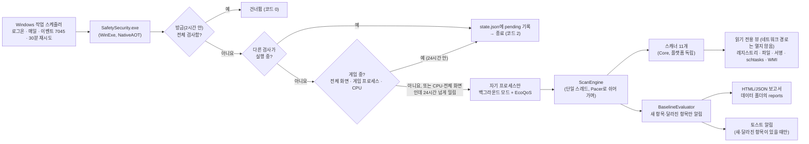

# 구조 / Architecture

## 두 개의 프로젝트

| 프로젝트 | 대상 | 하는 일 |
|---|---|---|
| `src/SafetySecurity.Core` | `net10.0` (어디서나) | 모델, 경로 분류, 명령줄 분석, `.lnk`·PE·작업 XML 파서, **스캐너 11개**, 베이스라인, 검사 일정 규칙, 보고서. Windows API를 직접 쓰지 않아서 macOS·Linux에서도 테스트할 수 있어요. |
| `src/SafetySecurity` | `net10.0-windows`, NativeAOT | Core가 쓰는 인터페이스(`IRegistryView`, `IFileSystemView`, `ISignatureVerifier`, `ITaskSource`, `IWmiSource`)의 Windows 구현, 게임 감지, 부하 조절, 작업 등록, 알림, 명령줄 |

스캐너는 `IScanner`를 구현하고 `ScanContext`로 읽기 전용 도구만 받아요. 그래서 테스트에서는 `FakeRegistry`·`FakeFileSystem`을 넣어 실제 Windows 없이 규칙을 검증해요.
`ScanContext`는 받은 파일 보기와 서명 확인에 항상 `LocalOnlyFileSystemView`·`LocalOnlySignatureVerifier`를 씌워서, 어떤 스캐너도 네트워크 경로를 열 수 없어요.

## 주요 파일

| 파일 | 설명 |
|---|---|
| `Core/Scanners/ComHijackScanner.cs` | HKCU CLSID ↔ HKLM 비교 (핵심 규칙) |
| `Core/Scanners/DiscordScanner.cs` | 디스코드 `discord_desktop_core\index.js` 변조 (`DISC-001`/`DISC-002`). 폴더 목록과 1MB 이하 파일 두 개만 읽고 링크는 따라가지 않아요 |
| `Core/Scanners/ScheduledTaskScanner.cs` | 예약 작업. SafetySecurity 이름을 쓴 작업은 이름·실행 파일·인자로 확인해요 (`TASK-003`/`TASK-004`) |
| `Core/Rules/ExecutableAssessor.cs` | 파일 하나 평가: 위치, 서명, 최근 여부, 숨김 속성. 네트워크 경로는 열지 않고 경로만으로 평가 |
| `Core/Rules/CommandAssessor.cs`, `CommandLineHeuristics.cs` | 명령줄 → 실행 파일·페이로드, LOLBin 악용 패턴, PowerShell 스위치 해석 |
| `Core/Rules/LauncherCommands.cs` | `cmd /c`·`start`·`conhost`·`forfiles`·`pcalua`·`wmic`·PowerShell `Start-Process` 등을 풀어서 실제로 실행되는 명령을 찾아요 (최대 3겹) |
| `Core/Rules/ShortcutTargets.cs`, `Core/Parsing/LnkParser.cs` | 바로가기 대상을 Windows와 같은 순서(환경 변수 블록 → IDList → LinkInfo → 상대 경로)로 해석 |
| `Core/Abstractions/LocalOnly.cs` | 네트워크 경로(`\\server\share`, `\\?\UNC\…`, WebDAV, 네트워크 드라이브)를 막는 파일·서명 보기 |
| `Core/Baseline/BaselineEvaluator.cs`, `FindingFingerprint.cs` | 새 항목·달라진 항목(위험도 상승, 서명·서명자·SHA-256 변경) 판단, 알림 대상 선택 |
| `Core/Baseline/IgnoreList.cs` | 숨김 목록: ID 찾기(앞 8자리 이상), 숨길 때 상태 기록, 검사 중에 바뀐 숨김 지키기 |
| `Core/Baseline/ScanSchedule.cs` | 언제 검사하고 언제 미룰지 (방금 검사함, 겹친 검사, 24시간 넘게 밀린 검사) |
| `Core/Install/OwnTasks.cs` | 우리 예약 작업의 이름과 인자. `TaskXmlBuilder`·`TaskInstaller`·`ScheduledTaskScanner`가 함께 써요 |
| `Core/Install/SelfExecutables.cs` | '검사기 자신'으로 볼 exe 경로 (관리자 검사는 사용자가 바꿀 수 있는 경로를 믿지 않아요) |
| `Core/Install/DataRoots.cs` | 데이터 폴더 위치 (일반 권한 / 관리자 권한) |
| `Core/Install/ChildEnvironment.cs` | 자식 프로세스에 줄 최소 환경 변수 |
| `Core/Reporting/HtmlReport.cs` | 외부 리소스 없는 보고서, CSP로 스크립트 차단, 모든 값 HTML 인코딩 |
| `SafetySecurity/Windows/AuthenticodeVerifier.cs` | `WinVerifyTrust` + 카탈로그, 폐기 확인 끔(오프라인), 네트워크 경로 거절 |
| `SafetySecurity/Windows/ChildProcess.cs` | `schtasks.exe`·`powershell.exe`를 System32 전체 경로와 최소 환경으로 실행. 시간이 넘으면 그 프로세스 하나만 끝내요 |
| `SafetySecurity/Windows/NetworkDrives.cs` | 네트워크 드라이브 문자 찾기 (`GetLogicalDrives` + `QueryDosDevice`, 이 PC의 드라이브 문자 연결만 읽어요) |
| `SafetySecurity/Runtime/GameDetector.cs` | 핸들을 열지 않는 게임 감지 |
| `SafetySecurity/Runtime/DataStore.cs` | 데이터 폴더 읽기·쓰기 (임시 파일에 쓰고 바꿔치기) |
| `SafetySecurity/Runtime/Throttle.cs` | 백그라운드 모드, 검사 잠금(`ScanLock`), 상태 파일 잠금(`StateLock`) |
| `SafetySecurity/Install/TaskInstaller.cs` | 작업 XML 등록 (`Core/Install/TaskXmlBuilder.cs`가 생성) |
| `installer/SafetySecurity.iss` | 설치 프로그램 (Inno Setup). 파일, 시작 메뉴, 바탕화면 바로가기(선택 작업 `desktopicon`, 기본으로 켜짐), 앱 목록, Win+R 이름(App Paths)만 맡고 작업 등록은 `install --quiet` / `uninstall --quiet`에 맡겨요. 다른 설치 방식으로 이미 설치돼 있으면 멈춰요. 관리자 설치를 제거하면 `{app}\data`도 지워요. 설치 폴더는 `TaskInstaller`와 같아요. `AppId`는 고정이에요 |

## 안전장치

1. **빌드 시간**: `BannedSymbols.txt` + `Microsoft.CodeAnalysis.BannedApiAnalyzers` → 금지 API를 쓰면 `RS0030` 빌드 에러가 나요.
   예외는 `Runtime/DataStore.cs`(자기 데이터 폴더), `Install/TaskInstaller.cs`(사용자가 직접 실행하는 설치)뿐이에요.
   프로세스 트리를 끝내는 `Process.Kill(bool)`도 막혀 있어요 (모든 프로세스를 열어 보기 때문이에요).
2. **테스트 시간**: `ForbiddenApiTests`가 소스의 모든 `[LibraryImport]`를 검사해서 `OpenProcess`·`WriteProcessMemory`·`SetWindowsHookEx`·`ws2_32`·`wininet` 등을 막아요. 예외 파일 목록도 고정해 둬요.
3. **실행 시간**: 레지스트리는 `KEY_READ`, 파일은 `FileAccess.Read` + 공유 모드로만 열어요. 매니페스트는 `asInvoker`라 스스로 권한을 올리지 않아요. 네트워크 경로는 `LocalOnly` 보기가 막아요.
4. **자식 프로세스**: `schtasks.exe`·`powershell.exe`는 System32 전체 경로로, 사용자 환경 변수를 물려주지 않고 `ChildEnvironment`가 만든 최소 환경으로 실행해요 (`PSModulePath`는 시스템 모듈 폴더로 고정). 시간이 넘으면 이미 가진 핸들로 그 프로세스 하나만 끝내요.
5. **관리자 권한**: 관리자 권한 프로세스는 사용자가 쓸 수 있는 데이터 폴더를 쓰지 않고(`DataRoots`), 사용자가 바꿀 수 있는 exe를 '검사기 자신'으로 보지 않아요(`SelfExecutables`).

## 데이터 폴더

| 누가 실행했나요 | 데이터 폴더 |
|---|---|
| 일반 권한 (사용자 작업, 바탕화면·시작 메뉴, Win+R) | `%LOCALAPPDATA%\SafetySecurity\` |
| 관리자 권한 (`Admin`·`ServiceInstalledAdmin` 작업, `install --admin`, 관리자 설치·제거, 관리자 셸, UAC를 끈 PC) | `C:\Program Files\SafetySecurity\data\` (Program Files의 권한을 물려받아 관리자만 바꿀 수 있어요) |

`--data-dir <폴더>`를 주면 둘 다 그 폴더로 바뀌어요 (시험용). 관리자 권한 프로세스는 `%LOCALAPPDATA%\SafetySecurity`를 읽지도 쓰지도 않아요.
`status`는 일반 권한에서도 관리자 데이터 폴더를 읽기만 해서 관리자 검사 상태를 보여줘요. `ignore`·`unignore`로 관리자 검사 항목을 바꿀 때는 관리자 권한으로 다시 실행해요(UAC).

| 파일 | 내용 |
|---|---|
| `state.json`, `state.admin.json` | 마지막 검사, 미뤄둔 검사, 베이스라인, 무시 목록 (아래) |
| `sigcache*.json` | 서명 확인 캐시 (경로 + 크기 + 수정 시각, 30일) |
| `config.json` | 게임 목록, 알림 기준, CPU 기준. 데이터 폴더마다 따로 있어요. 없으면 검사를 마칠 때 기본값으로 만들어요 |
| `reports\` | 최근 30개 보고서 (HTML + JSON) |
| `logs\scan.log` | 검사 기록 (1MB에서 교체). 미룸·건너뜀·겹친 검사도 남겨요 |

### 상태 파일 (`state*.json`)

버전 2는 버전 1의 칸을 그대로 두고 새 칸만 더했어요. 새 칸은 모두 없어도 돼서, 예전 버전도 새 파일을 읽고 새 버전도 예전 파일을 읽어요.

| 칸 | 내용 |
|---|---|
| `baseline`, `ignored` | (버전 1) 지난 검사에서 본 항목 ID → 분류, 숨긴 항목 ID |
| `baselineDetail` | 항목 ID → 그때의 위험도, 파일 지문(서명 상태, 서명자, SHA-256 앞 16자리), 제목. 같은 자리의 항목이 더 위험해지거나 파일이 바뀌면 다시 알리려고 기억해요 |
| `ignoredDetail` | 숨긴 항목 ID → 숨길 때의 제목, 분류, 시각, 위험도, 파일 지문. 그 뒤로 더 위험해지거나 파일이 바뀌면 다시 보여줘요 |
| `initializedCategories` | 한 번이라도 끝까지 검사한 분류. 여기 없는 분류는 첫 검사처럼 '높음'만 알려요 |
| `pending` | 미뤄둔 검사. `requestedUtc`(처음 요청), `overdueRunUtc`(밀려서 백그라운드로 검사한 시각), `overdueNoticeUtc`(밀렸다고 알린 시각) |

상태 파일 저장과 `ignore`·`unignore`는 파일마다 이름 있는 뮤텍스(`Local\SafetySecurity.State.<해시>`)로 짧게 잠그고 읽고-고치고-써요. 검사는 저장할 때 파일을 다시 읽어서, 검사 중에 바뀐 숨김 목록을 지켜요.

일부만 읽은 분류(작업 목록을 못 읽음, 작업 XML이 깨짐 등)는 보고서에 '(일부만 확인)'으로 보여주고, 그 분류의 예전 베이스라인 항목은 지우지 않아요. 그래야 다음에 제대로 읽혔을 때 같은 항목을 새 항목으로 다시 알리지 않아요.

## 예약 작업 이름과 인자

작업 이름과 인자는 `src/SafetySecurity.Core/Install/OwnTasks.cs` 한 곳에 있어요. `ScheduledTaskScanner`는 이 값과 정확히 같은 작업만 SafetySecurity 작업으로 봐서, 인자를 바꾸면 `tools/Test-OnMyPC.ps1`의 `$ownArgs`도 같이 바꿔야 해요.

## 알려진 한계

알고 있지만 아직 고치지 않은 것들(표준 계정에서의 관리자 설치, v0.1.0 zip 설치에서 넘어올 때 남는 관리자 작업, 관리자 PowerShell의 .NET 사용자 설정, 디스코드 폴더 링크 등)은 [SECURITY.md](../SECURITY.md#알려진-한계--known-limitations)에 모아 뒀어요.
